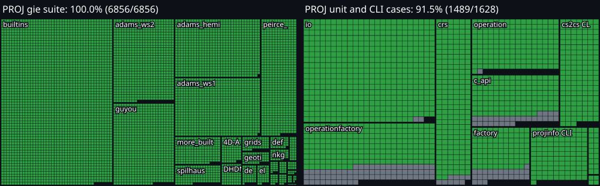

<h1 align="center">PROJ-RS</h1>

<p align="center">
  <b>PROJ 9.9, ported to Rust.</b><br>
  The same numbers as PROJ, a Rust API, and no libproj to install.
</p>

<p align="center">
  <a href="https://github.com/OSGeo/PROJ"></a>
  <a href="https://www.rust-lang.org"></a>
  <a href="LICENSE"></a>
  
</p>

PROJ-RS is a Rust port of [PROJ](https://github.com/OSGeo/PROJ), the
reference library for map projections and coordinate transformations. The goal
is the **same observable behavior as PROJ 9.9** on every ported operation,
checked against PROJ's own test suite, behind an API that uses `Result` and
enums instead of error codes and `NaN` sentinels.

It targets Rust projects that use the [`proj`](https://github.com/georust/proj)
crate: same API, one line changed in `Cargo.toml`, no libproj to build or
install. That claim is checked by georust's own unit tests and is **not complete
yet**: see [Status at a glance](#status-at-a-glance).

- **Checked against PROJ itself.** The numeric oracle is the PROJ 9.9.0
  `test/gie` suite, vendored unchanged under [`tests/gie/`](tests/gie). The
  conformance numbers below come from PROJ's tests, not from tests written
  for this crate.
- **Fails closed.** An unknown `+proj`, an unknown method, or a missing grid is
  an error when you build the operation. It is never a coordinate.
- **Self-contained.** PROJ 9.9's `proj.db` is embedded, so EPSG codes resolve
  without a PROJ install, a `PROJ_DATA` directory, or a system SQLite.
- **Strict by default.** Clippy runs with `-D warnings`, `unwrap()` is banned
  outside tests, every `unsafe` block needs a `// SAFETY:` comment, and a
  ratchet fails the test run if the PROJ pass count ever drops.

## Progress

<p align="center">
  
</p>

Each square is **one test case of PROJ 9.9.0 itself**. Green: PROJ-RS passes it.
Grey: still open. In all, <!--gen:all_percent-->97.2<!--/gen-->% of the cases pass
(<!--gen:all_done-->8248<!--/gen--> of <!--gen:all_total-->8484<!--/gen-->). The left panel is the numeric suite (`gie`), complete. The right
panel is what is left: PROJ's C++ unit tests, which cover the ISO 19111 model,
WKT and the operation factory, and the command-line cases. The chart is drawn
from the same ledgers as the tables below by `tests/progress_svg.rs`, so it
cannot say more than the tests do.

## How the port is done

PROJ-RS is not checked against tests written for it. It is checked against
PROJ's own, and a case counts only when it passes.

1. **PROJ is the oracle.** The `gie` files are vendored unchanged and run by a
   Rust runner. The C++ unit tests and the CLI cases are ported one `TEST()` at
   a time, with PROJ's expected strings kept as written. A test is never edited
   to fit the code: when the Rust output differs from PROJ, the test stays open
   and its cause is written down.
2. **What is open is listed by name.** [`docs/UNPORTED-UNIT.md`](docs/UNPORTED-UNIT.md)
   and [`docs/UNPORTED-CLI.md`](docs/UNPORTED-CLI.md) hold every open case. A name leaves
   a ledger only when its case passes, and the counts in this README, in the
   [roadmap](ROADMAP.md) and in the chart are computed from them. A test fails
   when they drift.
3. **A ratchet, so nothing slides back.** `tests/gie/passing.txt` and
   `tests/gie/files.txt` hold the pass counts, and a CLI case that used to pass
   fails the run if it stops. Tolerances are PROJ's own, never loosened.
4. **One lot, one topic.** Each pull request ports one topic and comes with a
   [`docs/PORTING-*.md`](docs) sheet: the function map, the deliberate
   deviations, what stays open and why, the commands that were run.
5. **Value first.** The open unit tests are sorted by name into `core` (a result
   a user sees: WKT, PROJ string, chosen operation), `niche` (rare CRS kinds)
   and `shape` (the C++ object model, which the Rust API does not mirror on
   purpose). See [`docs/UNIT-TRIAGE.md`](docs/UNIT-TRIAGE.md).
6. **Parity with the crate it replaces.** The unit tests of georust `proj` 0.31
   run against the facade ([`tests/georust_parity.rs`](tests/georust_parity.rs)):
   <!--gen:georust_pass-->25<!--/gen--> of <!--gen:georust_total-->25<!--/gen--> pass today. The others are marked
   `#[ignore = "gap: ..."]` with their cause, so a gap is a finding on the page and not
   a surprise later. CI also compares the facade with the reference `cs2cs` on named CRS pairs.
7. **Fail closed.** An unknown `+proj`, an unsupported method or a missing grid
   is an error when the operation is built, never a coordinate.

## Status at a glance

| Area | | What works today |
|---|:-:|---|
| Projections and conversions | ✅ | **189 operations** build and run; `builtins.gie` passes **2,597 / 2,597** |
| Pipelines, `cart`, Helmert, Molodensky, `unitconvert`, `affine`, `axisswap` | ✅ | `+proj=pipeline` with `+step` and `+inv`, exercised across PROJ's suite (`more_builtins`, `4D-API_cs2cs-style`, `axisswap`, `unitconvert`) |
| Grid shifts, `tinshift`, deformation models | ✅ | All `gie` files green. The PROJ 9.9.0 test grids live in [`data/tests/`](data/tests). CDN grids are fetched with `PROJ_NETWORK=ON`, as in PROJ's own tests |
| Embedded `proj.db` and EPSG resolution | ✅ | Built from the PROJ 9.9.0 SQL, opened in memory with `rusqlite` |
| ISO 19111 model, WKT and PROJJSON | 🟡 | CRS model, authority factory, CRS identification against `proj.db`, WKT1 and WKT2 import and export, PROJJSON. See [`docs/CRS-API.md`](docs/CRS-API.md) |
| georust `proj` facade | 🟡 | `Proj`, `ProjBuilder`, `Coord`, `Transform`, `Area`, errors and the `geo-types` feature exist. <!--gen:georust_pass-->25<!--/gen--> of <!--gen:georust_total-->25<!--/gen--> of georust `proj` 0.31's own unit tests pass against it ([`tests/georust_parity.rs`](tests/georust_parity.rs)); the rest are listed there as gaps |
| Command-line tools | 🟡 | `cct`, `cs2cs`, `proj`, `projinfo` over the library; <!--gen:cli_matched-->220<!--/gen--> of <!--gen:cli_total-->276<!--/gen--> PROJ CLI cases match |
| SIMD batch path | ✅ | AVX2 on x86-64. Other targets run the scalar loop |

✅ done and verified &nbsp;·&nbsp; 🟡 working, with known gaps listed below

## Conformance with PROJ

### The `gie` suite

PROJ describes its own behavior in `test/gie/*.gie` files. PROJ-RS runs all of
them, untouched, with a Rust runner. A case it cannot build counts as
**skipped**, never as passed. A case that builds but misses PROJ's tolerance
is a **failure**, and tolerances are never loosened.

> **6,856 of 6,856 cases pass (100%).**
> 6,811 run offline, and all pass. The other 45 cases read grids from
> `https://cdn.proj.org`, so they run with `PROJ_NETWORK=ON`. PROJ's
> `test/CMakeLists.txt` splits its suite the same way.

<details>
<summary><b>26 files, all green</b>: per-file results with `PROJ_NETWORK=ON`</summary>

<br>

| File | Cases | Pass | Not yet | |
|---|---:|---:|---:|:-:|
| `4D-API_cs2cs-style.gie` | 78 | 78 | 0 | ✅ |
| `DHDN_ETRS89.gie` | 64 | 64 | 0 | ✅ |
| `GDA.gie` | 3 | 3 | 0 | ✅ |
| `adams_hemi.gie` | 703 | 703 | 0 | ✅ |
| `adams_ws1.gie` | 703 | 703 | 0 | ✅ |
| `adams_ws2.gie` | 722 | 722 | 0 | ✅ |
| `axisswap.gie` | 27 | 27 | 0 | ✅ |
| `builtins.gie` | 2,597 | 2,597 | 0 | ✅ |
| `defmodel.gie` | 34 | 34 | 0 | ✅ |
| `deformation.gie` | 43 | 43 | 0 | ✅ |
| `ellipsoid.gie` | 37 | 37 | 0 | ✅ |
| `epsg_grid.gie` | 7 | 7 | 0 | ✅ |
| `epsg_no_grid.gie` | 6 | 6 | 0 | ✅ |
| `geotiff_grids.gie` | 51 | 51 | 0 | ✅ |
| `gridshift.gie` | 59 | 59 | 0 | ✅ |
| `guyou.gie` | 705 | 705 | 0 | ✅ |
| `hourglass.gie` | 12 | 12 | 0 | ✅ |
| `interrupted.gie` | 14 | 14 | 0 | ✅ |
| `more_builtins.gie` | 183 | 183 | 0 | ✅ |
| `nkg.gie` | 33 | 33 | 0 | ✅ |
| `peirce_q.gie` | 592 | 592 | 0 | ✅ |
| `spilhaus.gie` | 133 | 133 | 0 | ✅ |
| `tinshift.gie` | 15 | 15 | 0 | ✅ |
| `tinshift_gpkg.gie` | 14 | 14 | 0 | ✅ |
| `tinshift_gpkg_network.gie` | 5 | 5 | 0 | ✅ |
| `unitconvert.gie` | 16 | 16 | 0 | ✅ |
| **Total** | **6,856** | **6,856** | **0** | |

✅ every case passes

</details>

#### How the suite got here

| Step | Pass | Fail | Skipped | Share of 6,856 |
|---|---:|---:|---:|---|
| PROJ 9.9 builtins complete | 2,743 | 0 | 4,113 | `████████░░░░░░░░░░░░` 40.0% |
| `proj.db`, Adams, Guyou, Peirce, Spilhaus | 6,301 | 0 | 555 | `██████████████████░░` 91.9% |
| Conversions, test grids, deformation models | 6,657 | 0 | 199 | `███████████████████░` 97.1% |
| CDN grids present on disk | 6,678 | 0 | 178 | `███████████████████░` 97.4% |
| PROJ 9.9.0 test data vendored, CTABLE2 sign, NKG, `epsg_grid`, network `tinshift` | 6,856 | 0 | 0 | `████████████████████` 100% |

Offline, the 45 CDN cases are not run, so the offline count is 6,811 / 6,811.
The last row is the state of this checkout. `tests/gie/passing.txt` holds the
live count for each mode, `offline` and `network`, and the test fails if the
count moves without that file moving with it.

### Unit tests and CLI cases

PROJ's C++ unit tests are ported one `TEST()` at a time, and the ones not
ported yet are listed by name in [`docs/UNPORTED-UNIT.md`](docs/UNPORTED-UNIT.md).
The same goes for the CLI cases in [`docs/UNPORTED-CLI.md`](docs/UNPORTED-CLI.md).

| Suite | Ported and passing | Not yet | |
|---|---:|---:|:-:|
| PROJ C++ unit tests | <!--gen:unit_ported-->1172<!--/gen--> | <!--gen:unit_open-->180<!--/gen--> | <!--gen:unit_icon-->🟡<!--/gen--> |
| `cct` CLI cases | <!--gen:cli_cct_ported-->18<!--/gen--> | <!--gen:cli_cct_open-->0<!--/gen--> | <!--gen:cli_cct_icon-->✅<!--/gen--> |
| `cs2cs` CLI cases | <!--gen:cli_cs2cs_ported-->123<!--/gen--> | <!--gen:cli_cs2cs_open-->20<!--/gen--> | <!--gen:cli_cs2cs_icon-->🟡<!--/gen--> |
| `proj` CLI cases | <!--gen:cli_proj_ported-->4<!--/gen--> | <!--gen:cli_proj_open-->0<!--/gen--> | <!--gen:cli_proj_icon-->✅<!--/gen--> |
| `projinfo` CLI cases | <!--gen:cli_projinfo_ported-->75<!--/gen--> | <!--gen:cli_projinfo_open-->36<!--/gen--> | <!--gen:cli_projinfo_icon-->🟡<!--/gen--> |

✅ complete &nbsp;·&nbsp; 🟡 partial &nbsp;·&nbsp; 🔴 mostly open

<details>
<summary><b>Unit tests by PROJ source file</b></summary>

<br>

| PROJ file | Ported and passing | Not yet |
|---|---:|---:|
| `test_c_api.cpp` | <!--gen:test_c_api_ported-->123<!--/gen--> | <!--gen:test_c_api_open-->29<!--/gen--> |
| `test_crs.cpp` | <!--gen:test_crs_ported-->186<!--/gen--> | <!--gen:test_crs_open-->11<!--/gen--> |
| `test_factory.cpp` | <!--gen:test_factory_ported-->87<!--/gen--> | <!--gen:test_factory_open-->26<!--/gen--> |
| `test_io.cpp` | <!--gen:test_io_ported-->452<!--/gen--> | <!--gen:test_io_open-->2<!--/gen--> |
| `test_operation.cpp` | <!--gen:test_operation_ported-->161<!--/gen--> | <!--gen:test_operation_open-->1<!--/gen--> |
| `test_operationfactory.cpp` | <!--gen:test_operationfactory_ported-->163<!--/gen--> | <!--gen:test_operationfactory_open-->111<!--/gen--> |
| Other unit files ([`tests/proj_unit.rs`](tests/proj_unit.rs)) | 33 | n/a |

The unit tests are the biggest remaining piece: they cover the ISO 19111 model,
WKT and the operation factory, which the `gie` suite barely touches.

</details>

The unit and CLI counts are computed from the two ledgers by
`tests/docs_in_sync.rs`, which fails when this file drifts (`UPDATE_DOCS=1`
rewrites it). The `gie` counts are as of 2026-10-30. The CLI counts come from
the ledger committed in the repository; a fresh Linux checkout without grids matches two fewer
`cs2cs` cases.

## Quick start

PROJ-RS is not on crates.io yet. Use it from git:

```toml
[dependencies]
proj-rs = { git = "https://github.com/RandazzoMaxime/proj-rs" }
```

Already using the `proj` crate? Swap it without touching your Rust code. Check
the [parity status](#how-the-port-is-done) first: a few results still differ
from PROJ's, which the georust gaps list:

```toml
proj = { package = "proj-rs", git = "https://github.com/RandazzoMaxime/proj-rs" }
```

### As a library

```rust
use proj_rs::Proj;

fn main() -> Result<(), Box<dyn std::error::Error>> {
    // The Eiffel Tower, in WGS 84 longitude and latitude (degrees).
    let eiffel = (2.2945_f64, 48.8584_f64);

    // EPSG codes resolve from the embedded PROJ 9.9 database. No libproj.
    let to_lambert93 = Proj::new_known_crs("EPSG:4326", "EPSG:2154", None)?;
    let (east, north) = to_lambert93.convert(eiffel)?;
    println!("Lambert-93 (EPSG:2154): {east:.3} E  {north:.3} N");

    // A plain PROJ string works too.
    let to_utm = Proj::new("+proj=utm +zone=31 +ellps=WGS84")?;
    let radians = (eiffel.0.to_radians(), eiffel.1.to_radians());
    let (east, north) = to_utm.project(radians, false)?;
    println!("UTM 31N (PROJ string):  {east:.3} E  {north:.3} N");

    // Anything this crate cannot do is an error at creation, never a wrong number.
    let refused = Proj::new("+proj=not_a_real_projection");
    println!("Unknown projection:     {}", refused.is_err());

    Ok(())
}
```

```text
$ cargo run --example quickstart
Lambert-93 (EPSG:2154): 648237.302 E  6862271.682 N
UTM 31N (PROJ string):  448252.001 E  5411954.910 N
Unknown projection:     true
```

This is [`examples/quickstart.rs`](examples/quickstart.rs).

### On the command line

`cs2cs`, `cct`, `proj` and `projinfo` are thin binaries over the library and
follow the PROJ originals:

```text
$ echo "2.2945 48.8584" | cargo run -q --bin cs2cs -- -d 3 +proj=longlat +datum=WGS84 +to EPSG:2154
648237.302	6862271.682 0.000
```

As in PROJ, `EPSG:4326` on the command line reads latitude first. Use a
`+proj=longlat` string, as above, for longitude first.

## Requirements and platforms

- **Rust 1.83 or newer.**
- **A C compiler.** `cargo build` compiles two small vendored C libraries:
  SQLite (through `rusqlite`) and Charles Karney's geodesic code. There is no
  libproj, no CMake, and no system SQLite.
- **OpenSSL development files on Linux.** They are needed only for the on-demand
  grid download (`native-tls`). Windows and macOS use the system TLS.
- **Dependencies stay small.** Three direct ones (`rusqlite`, `tiff`,
  `native-tls`), a fourth optional (`geo-types`), 37 crates in the default tree.

The batch path (`forward_batch`) uses AVX2 on x86-64. On Linux glibc it calls
libmvec. On Windows it uses the C runtime math library, one lane at a time.
Other targets run the scalar loop. CI builds on Ubuntu 24.04 and Windows, and checks
against the PROJ 9.9.0 binaries from conda-forge.

### Grids

Grids are not stored in git, with two exceptions. [`data/tests/`](data/tests)
holds the test grids of PROJ 9.9.0 (`data/tests` in the PROJ source tree, which
PROJ copies into its test directory), and that is all the offline suite needs.
Other grids are looked up in `data/grids/` (git-ignored), then
`tests/gie/tests/`, `data/tests/` and `tests/gie/`.

Downloading is **off by default**. Set `PROJ_NETWORK=ON` to fetch a missing grid
from `https://cdn.proj.org`, the way PROJ does. Fetched grids are cached in the
temporary directory under `proj/`. Without the grid the operation fails to
build, with a clear error.

## Performance

`src/bin/bench.rs` times every ported operation in nanoseconds per point, on
fixed grids. `bench/record.sh` appends one line per run to
[`bench/history.jsonl`](bench/history.jsonl) with the commit and machine name,
so each change can be measured against the last.

To fill the `speedup` column, point the build at a libproj: set
`PROJ_RS_LIBPROJ_DIR` to the directory that holds it, or activate a conda
environment with `proj` installed (`CONDA_PREFIX`). Without one the bench still
runs and leaves `speedup` empty.

The two timing columns come from **different machines**, so compare them only
with a column from the same machine. `speedup` is libproj's time divided by
this port's time on the same run, so `1.5×` means this port is 1.5 times
faster than libproj. The 2026-10-28 column was recorded when the suite had
2,743 passing cases and has not been re-run since.

| Case | 2026-10-27 scalar (ns) | 2026-10-28 AVX2 (ns) | libproj (ns) | speedup |
|---|---:|---:|---:|---:|
| UTM 31 forward | 81.5 | 82.2 | 113.4 | 1.4× |
| UTM 31 inverse | 79.0 | 90.1 | | |
| Lambert-93 forward | 50.3 | 54.7 | 91.3 | 1.7× |
| Lambert-93 inverse | 138.5 | 163.3 | | |
| Web Mercator forward | 19.3 | 41.5 | 67.7 | 1.6× |
| Web Mercator inverse | 25.0 | 35.6 | | |
| UTM batch, zone center | 80.0 | 50.2 | | |
| UTM batch, zone edge | 75.0 | 44.3 | | |
| Lambert-93 batch | 47.5 | 34.2 | | |
| Helmert 7-parameter | 7.3 | 7.1 | | |

Timings are nanoseconds (ns) per point, over one million points. `speedup` is
libproj's ns divided by the AVX2 ns of the same run. The first column is
`maxime-win11-nosimd` at `b405008`. The second is `RANDAZZOPROD`,
`batch_path=avx2`, at dirty `16408a8`.

<details>
<summary><b>Ten slowest operations</b> (same run, 128-point catalogue grid)</summary>

<br>

| Operation | ns/point |
|---|---:|
| `gnom` | 396.9 |
| `aeqd` | 394.5 |
| `lsat` | 356.3 |
| `misrsom` | 343.8 |
| `dsea` | 248.4 |
| `isea` | 194.5 |
| `ivea` | 193.0 |
| `calcofi` | 180.5 |
| `tsea` | 176.6 |
| `mod_krovak` | 157.0 |

</details>

Record your own row, and compare only lines from the same machine, with the
process pinned (`taskset -c 0`) for stable numbers:

```bash
BENCH_MACHINE=my-box bench/record.sh
```

## Reproduce these numbers

```bash
cargo fmt --check
cargo clippy --all-targets --all-features -- -D warnings

# Per-file gie counts, the table above. Offline first, then with the network
# files (PROJ's network-dependent tests use the same switch):
cargo test --all-features --test gie_run -- --nocapture
PROJ_NETWORK=ON cargo test --all-features --test gie_run -- --nocapture

# Everything:
cargo test --all-features

# After a lot, refresh the counts, the triage and the chart from the ledgers:
UPDATE_DOCS=1 cargo test --test docs_in_sync --test progress_svg

# The known gaps of the georust facade, each with its cause:
cargo test --test georust_parity -- --ignored
```

`tests/agree_cs2cs.rs` calls a PROJ `cs2cs` binary found on `PATH` as a
differential check. It is a cross-check only: the numbers that decide a pass
are the vendored PROJ 9.9.0 `.gie` expectations. The check is skipped when no
`cs2cs` is on `PATH`, unless `PROJ_CS2CS_REQUIRED=1` is set, as in CI.

## Project layout

| Path | What lives there |
|---|---|
| [`src/projections/`](src/projections) | One module per PROJ operation family: projections, conversions, datum operations, grid and deformation models |
| [`src/engine.rs`](src/engine.rs) | The PROJ string parser, `Operation::create`, and the pipeline engine |
| [`src/iso19111/`](src/iso19111) | CRS model, WKT, authority factory, operation factory |
| [`src/proj.rs`](src/proj.rs) | The georust `proj`-compatible facade |
| [`src/projdb.rs`](src/projdb.rs), [`data/proj.db`](data) | The embedded PROJ 9.9 database |
| [`src/network.rs`](src/network.rs), [`src/gridpath.rs`](src/gridpath.rs) | Grid lookup and on-demand download |
| [`src/bin/`](src/bin) | `cct`, `cs2cs`, `proj`, `projinfo`, and the bench |
| [`tests/gie/`](tests/gie) | The PROJ 9.9.0 `gie` suite, vendored unchanged |
| [`docs/PORTING-*.md`](docs) | One sheet per ported module: function map, deliberate deviations, commands run |

## Roadmap

The remaining work is in [ROADMAP.md](ROADMAP.md), in the order of what a user of
the `proj` crate needs: georust parity first, then the `cs2cs` gaps, the unit
tests by value, the `projinfo` text, and a portable batch path.

## Contributing

Contributions are welcome. Every change goes through a pull request, and the
maintainer merges. The procedure, the shape of a port PR, and the merge rule
are in [CONTRIBUTING.md](CONTRIBUTING.md).

## License and credits

PROJ-RS is released under the [MIT license](LICENSE). It stands on the work of
the PROJ authors, Charles Karney (geodesics), and Knud Poder and Karsten
Engsager (exact Transverse Mercator). Third-party notices are in
[NOTICE.md](NOTICE.md). Lints follow
[BeautifulRust](https://github.com/morganlinton/BeautifulRust).
