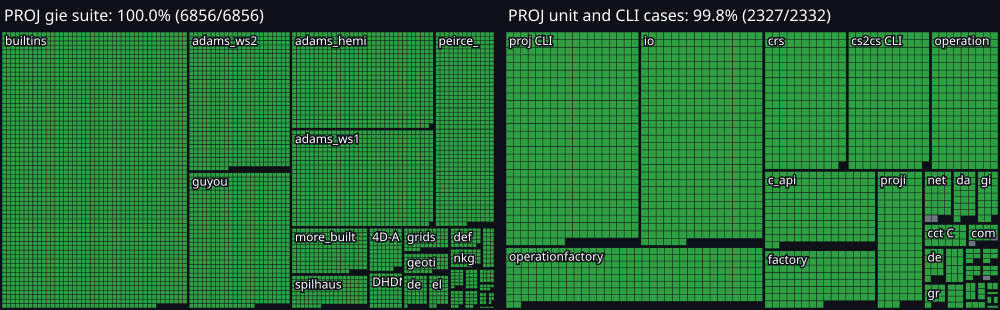
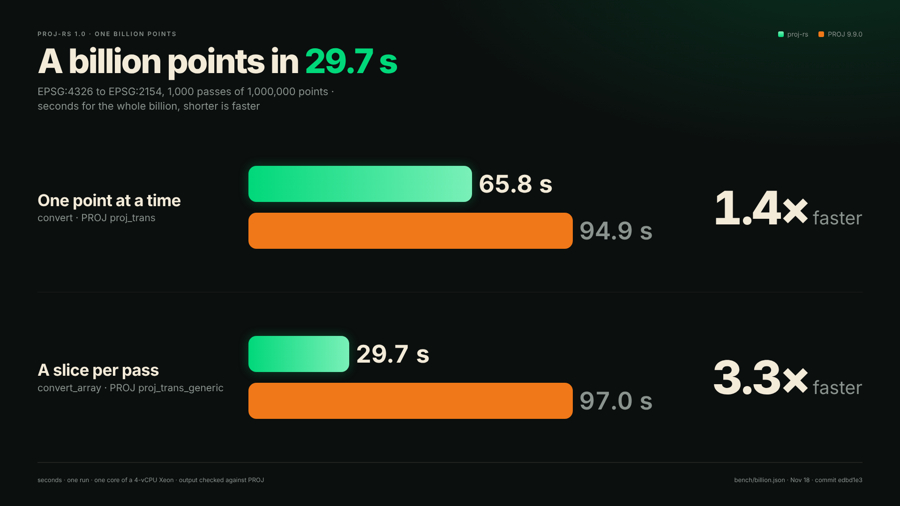
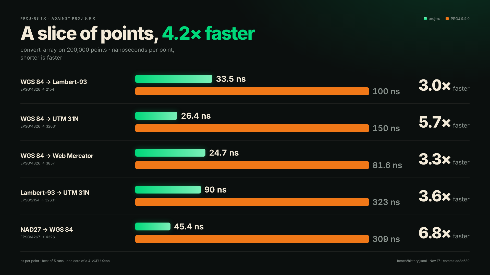
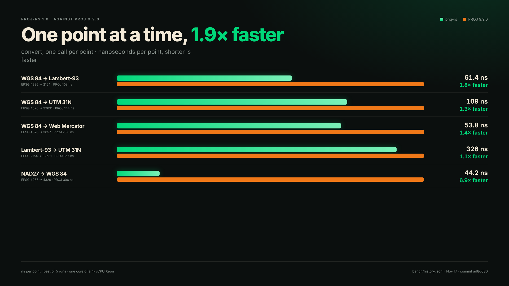
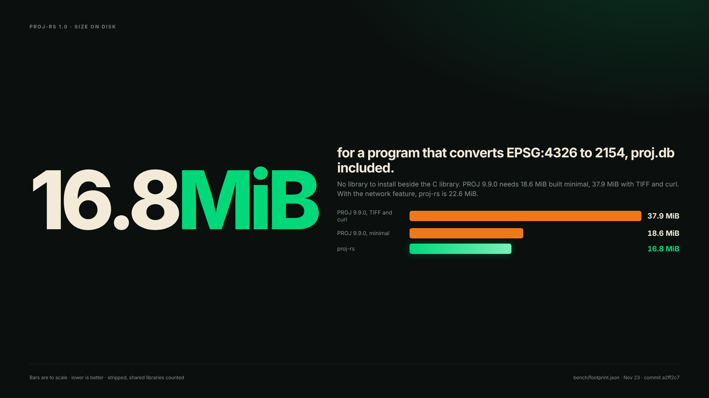
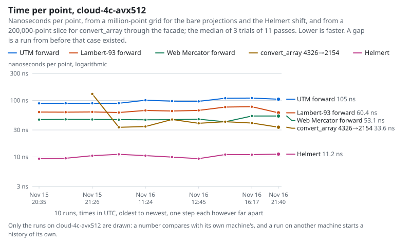

<h1 align="center">PROJ-RS</h1>

<p align="center">
  <b>PROJ 9.9, ported to Rust.</b><br>
  The same numbers as PROJ, a Rust API, and no libproj to install.
</p>

<p align="center">
  <a href="https://github.com/OSGeo/PROJ"></a>
  <a href="https://www.rust-lang.org"></a>
  <a href="LICENSE"></a>
  
</p>

PROJ-RS is a Rust port of [PROJ](https://github.com/OSGeo/PROJ), the
reference library for map projections and coordinate transformations. The goal
is the **same observable behavior as PROJ 9.9** on every ported operation,
checked against PROJ's own test suite, behind an API that uses `Result` and
enums instead of error codes and `NaN` sentinels.

It has three facades over one engine: a small native Rust API at the crate root, a
drop-in for the [`proj`](https://github.com/georust/proj) crate (one line changed in
`Cargo.toml`, no libproj to build or install), and a C API. The georust claim is checked
by georust's own unit tests and documentation examples and is **not complete yet**: see
[Status at a glance](#status-at-a-glance) and [Stability](#stability).

- **Checked against PROJ itself.** The numeric oracle is the PROJ 9.9.0
  `test/gie` suite, vendored unchanged under [`tests/gie/`](tests/gie). The
  conformance numbers below come from PROJ's tests, not from tests written
  for this crate.
- **Fails closed.** An unknown `+proj`, an unknown method, or a missing grid is
  an error when you build the operation. It is never a coordinate.
- **Self-contained.** PROJ 9.9's `proj.db` is embedded, so EPSG codes resolve
  without a PROJ install, a `PROJ_DATA` directory, or a system SQLite. No TLS
  library is built unless you turn on the `network` feature.
- **Fast, and lighter in memory.** Faster than `libproj` on the ten conversions
  measured, and under its peak memory in the five scenarios measured, on Linux
  x86-64. The numbers, the figures and the method are in [How fast](#how-fast).
- **Strict by default.** Clippy runs with `-D warnings`, `unwrap()` is banned
  outside tests, every `unsafe` block needs a `// SAFETY:` comment, and a
  ratchet fails the test run if the PROJ pass count ever drops.

## Progress

<p align="center">
  
</p>

Each square is **one test case of PROJ 9.9.0 itself**. Green: PROJ-RS passes it.
Grey: still open. In all, <!--gen:all_percent-->100.0<!--/gen-->% of the cases pass
(<!--gen:all_done-->9188<!--/gen--> of <!--gen:all_total-->9188<!--/gen-->). The left panel is the numeric suite (`gie`), complete. The right
panel is what is left: PROJ's C++ unit tests, which cover the ISO 19111 model,
WKT and the operation factory, and the command-line cases. The chart is drawn
from the same ledgers as the tables below by `tests/progress_svg.rs`, so it
cannot say more than the tests do.

## How fast

Speed, size on disk and peak memory of the same conversions, proj-rs against PROJ 9.9.0 on Linux x86-64, with the speed also on ARM (Apple M1, Linux ARM). The speed is measured by the CI; the size and the memory on a 4-vCPU cloud VM. Every number comes from a measurement file, [`bench/history.jsonl`](bench/history.jsonl) for the speed and [`bench/footprint.json`](bench/footprint.json) for the size and the memory, and the pictures and tables are drawn from them.

What the speed rests on: the batch path above, a pipeline that folds its axis-swap and unit steps into one
([`docs/PORTING-affine-plan.md`](docs/PORTING-affine-plan.md)), and, for the memory, a `proj.db` that is read from the
executable instead of being copied ([`docs/PORTING-memory.md`](docs/PORTING-memory.md)).

<!-- bench-compare:start -->





<!-- bench-compare:end -->

<!-- bench-how-fast:start -->
These numbers are proj-rs 1.2.5's, measured by the CI.

On a GitHub Actions runner (Linux x86-64, 4 vCPU), the process pinned to one core, proj-rs is 2.9× faster than PROJ 9.9.0's `libproj` on average over the ten cases below (geometric mean of the ratios; faster in every case, from 1.2× to 5.6×). One point at a time, proj-rs is 1.6× faster on average, from 1.2× to 5.0×. On a slice of points, it is 5.0× faster on average, from 4.6× to 5.6×. This is one machine: the ratios on another CPU, or on a build of libproj with other flags, will differ. The batch kernels take the AVX2 path, which every x86-64 CPU has since 2013 (Intel) and 2015 (AMD); AVX-512 is not used.

| Conversion | Call | PROJ 9.9.0 | proj-rs |
|---|---|---:|---:|
| WGS 84 → RGF93 / Lambert-93 (EPSG:4326 → 2154) | `convert`, one point at a time | 141 ns | 104 ns (1.4× faster) |
| WGS 84 → RGF93 / Lambert-93 (EPSG:4326 → 2154) | `convert_array`, 200,000 points | 149 ns | 32.6 ns (4.6× faster) |
| WGS 84 → WGS 84 / UTM 31N (EPSG:4326 → 32631) | `convert`, one point at a time | 173 ns | 150 ns (1.2× faster) |
| WGS 84 → WGS 84 / UTM 31N (EPSG:4326 → 32631) | `convert_array`, 200,000 points | 179 ns | 31.6 ns (5.6× faster) |
| WGS 84 → Web Mercator (EPSG:4326 → 3857) | `convert`, one point at a time | 108 ns | 90.7 ns (1.2× faster) |
| WGS 84 → Web Mercator (EPSG:4326 → 3857) | `convert_array`, 200,000 points | 115 ns | 22.3 ns (5.2× faster) |
| RGF93 / Lambert-93 → WGS 84 / UTM 31N (EPSG:2154 → 32631) | `convert`, one point at a time | 464 ns | 358 ns (1.3× faster) |
| RGF93 / Lambert-93 → WGS 84 / UTM 31N (EPSG:2154 → 32631) | `convert_array`, 200,000 points | 469 ns | 91.8 ns (5.1× faster) |
| NAD27 → WGS 84 (EPSG:4267 → 4326) | `convert`, one point at a time | 318 ns | 63.9 ns (5.0× faster) |
| NAD27 → WGS 84 (EPSG:4267 → 4326) | `convert_array`, 200,000 points | 319 ns | 68.8 ns (4.6× faster) |

Nanoseconds per point; lower is faster. Line of Nov 23 07:43 UTC at commit `4c609c6`, the best of 5 runs for each case. Both sides convert the same points, and the bench stops if their outputs differ. With no grid, NAD27 → WGS 84 is PROJ's ballpark offset on both sides, a change of units and axis order with no datum shift, which proj-rs applies as one step. What exactly is compared, and how to rerun it: [docs/BENCHMARK.md](docs/BENCHMARK.md).

<details>
<summary><b>Bare projections against libproj, and the ten slowest operations</b></summary>

<br>

Bare projections, forward, from `+proj=` strings (no CRS lookup), one point at a time over a million points:

| Projection | PROJ 9.9.0 | proj-rs |
|---|---:|---:|
| UTM 31 forward, `+proj=utm` | 158 ns | 112 ns (1.4× faster) |
| Lambert-93 forward, `+proj=lcc` | 128 ns | 80.9 ns (1.6× faster) |
| Web Mercator forward, `+proj=merc` | 98 ns | 64.7 ns (1.5× faster) |

Ten slowest operations of the catalogue (same line, a 128-point grid, no libproj column):

| Operation | ns/point |
|---|---:|
| `gnom` | 661.5 |
| `aeqd` | 658.0 |
| `lsat` | 593.9 |
| `misrsom` | 575.4 |
| `dsea` | 509.1 |
| `ivea` | 417.4 |
| `isea` | 417.4 |
| `tsea` | 394.2 |
| `chamb` | 320.3 |
| `spilhaus` | 314.3 |

</details>

### On ARM

The same ten cases on Apple M1 and Neoverse N2, two GitHub Actions runners (a virtual Apple M1 on macOS, not pinned; a Neoverse N2 on Linux, pinned to one core). The batch kernels take the NEON path; the ratio is PROJ 9.9.0's time over proj-rs's.

| Conversion | Call | PROJ 9.9.0, Apple M1 | proj-rs, Apple M1 | PROJ 9.9.0, Neoverse N2 | proj-rs, Neoverse N2 |
|---|---|---:|---:|---:|---:|
| WGS 84 → RGF93 / Lambert-93 (EPSG:4326 → 2154) | `convert` | 114 ns | 68 ns (1.7× faster) | 108 ns | 81 ns (1.3× faster) |
| WGS 84 → RGF93 / Lambert-93 (EPSG:4326 → 2154) | `convert_array` | 114 ns | 33.5 ns (3.4× faster) | 109 ns | 51.8 ns (2.1× faster) |
| WGS 84 → WGS 84 / UTM 31N (EPSG:4326 → 32631) | `convert` | 122 ns | 96.3 ns (1.3× faster) | 140 ns | 119 ns (1.2× faster) |
| WGS 84 → WGS 84 / UTM 31N (EPSG:4326 → 32631) | `convert_array` | 132 ns | 33.1 ns (4.0× faster) | 142 ns | 55 ns (2.6× faster) |
| WGS 84 → Web Mercator (EPSG:4326 → 3857) | `convert` | 67.4 ns | 66.7 ns (about the same, 1.01×) | 84.2 ns | 74 ns (1.1× faster) |
| WGS 84 → Web Mercator (EPSG:4326 → 3857) | `convert_array` | 66.9 ns | 21.6 ns (3.1× faster) | 84.6 ns | 37.4 ns (2.3× faster) |
| RGF93 / Lambert-93 → WGS 84 / UTM 31N (EPSG:2154 → 32631) | `convert` | 330 ns | 303 ns (1.1× faster) | 376 ns | 291 ns (1.3× faster) |
| RGF93 / Lambert-93 → WGS 84 / UTM 31N (EPSG:2154 → 32631) | `convert_array` | 340 ns | 92.5 ns (3.7× faster) | 378 ns | 136 ns (2.8× faster) |
| NAD27 → WGS 84 (EPSG:4267 → 4326) | `convert` | 228 ns | 31.9 ns (7.1× faster) | 243 ns | 45.6 ns (5.3× faster) |
| NAD27 → WGS 84 (EPSG:4267 → 4326) | `convert_array` | 223 ns | 34.2 ns (6.5× faster) | 246 ns | 50.1 ns (4.9× faster) |

On Apple M1, proj-rs is 2.6× faster than PROJ 9.9.0 on average over the ten cases (the slowest case is about the same, 1.01×, the fastest 7.1× faster); line of Nov 23 07:59 UTC at commit `4c609c6`, the best of 5 runs.

On Neoverse N2, proj-rs is 2.1× faster than PROJ 9.9.0 on average over the ten cases (faster in every case, from 1.1× to 5.3×); line of Nov 23 07:41 UTC at commit `4c609c6`, the best of 5 runs.
<!-- bench-how-fast:end -->

### Size and memory

<!-- bench-footprint:start -->
The same conversion, EPSG:4326 to EPSG:2154, measured on the same machine (Linux x86-64, glibc), proj-rs against PROJ 9.9.0.




On disk, a Rust program with proj-rs is 17.1 MiB with `proj.db` included (10.1 MiB of it) and no library other than the C library: 1.1× smaller than a C program with PROJ 9.9.0 built as in the speed comparison (18.6 MiB), and 2.2× smaller than one with a PROJ built with TIFF and curl (37.9 MiB). With the `network` feature (the HTTPS grid download, TLS from the system) the program is 22.9 MiB, of which 5.7 MiB is OpenSSL: 1.7× smaller than the PROJ with curl. The code of proj-rs alone, `proj.db` left out, is 7.0 MiB; an empty Rust program is 0.3 MiB.

In memory, creating the transform peaks at 12.1 MiB for proj-rs and 14.8 MiB for PROJ (1.2× less memory). With a million points one at a time it is 12.2 MiB and 14.7 MiB; as one array, 27.3 MiB and 29.9 MiB, the array of points itself being 15.3 MiB; with several candidate operations (EPSG:4267 to 4326), 13.0 MiB and 16.4 MiB.

<details>
<summary><b>Size and memory, component by component</b></summary>

<br>

Size on disk, after `strip --strip-unneeded`. A program is counted with every shared library `ldd` lists for it, except the C library and the unwinder (libc, libm, libdl, libpthread, librt, libutil, libgcc_s), on both sides. Nov 17 17:59 UTC, commit `ad8d680`.

| Install | Program and library | proj.db | Other shared libraries | of which OpenSSL | of which libcurl | Total, stripped | Total, as built |
|---|---:|---:|---:|---:|---:|---:|---:|
| PROJ 9.9.0, C program + libproj, TIFF and curl off | 4.7 MiB | 10.1 MiB | 3.9 MiB | none | none | **18.6 MiB** | 19.6 MiB |
| PROJ 9.9.0, C program + libproj, TIFF and curl on | 4.7 MiB | 10.1 MiB | 23.1 MiB | 5.7 MiB | 0.7 MiB | **37.9 MiB** | 38.9 MiB |
| proj-rs as libproj, same C program + libproj of capi/ | 8.3 MiB | 10.1 MiB | 0.0 MiB | none | none | **18.4 MiB** | 19.4 MiB |
| proj-rs, Rust program, proj.db inside | 7.0 MiB | 10.1 MiB | 0.0 MiB | none | none | **17.1 MiB** | 17.9 MiB |
| proj-rs, feature network, Rust program, HTTPS grid download | 7.1 MiB | 10.1 MiB | 5.7 MiB | 5.7 MiB | none | **22.9 MiB** | 23.7 MiB |

OpenSSL is `libssl` plus `libcrypto`, already inside the third column. proj-rs links it only with the `network` feature, for its HTTPS grid download, and takes it from the system (`native-tls`); PROJ pulls it through libcurl, when built with curl, together with the other libraries of curl (`libnghttp2`, `libssh`, `libgssapi_krb5`, `libldap`, `libgnutls` and more), which count in the third column but not in the libcurl column.

Shared libraries counted in the third column:

- PROJ 9.9.0, C program + libproj, TIFF and curl off: `libsqlite3.so.0.8.6`, `libstdc++.so.6.0.33`.
- PROJ 9.9.0, C program + libproj, TIFF and curl on: `libsqlite3.so.0.8.6`, `libtiff.so.6.0.1`, `libcurl.so.4.8.0`, `libstdc++.so.6.0.33`, `libwebp.so.7.1.8`, `libzstd.so.1.5.5`, `liblzma.so.5.4.5`, `libLerc.so.4`, `libjbig.so.0`, `libjpeg.so.8.2.2`, `libdeflate.so.0`, `libz.so.1.3`, `libnghttp2.so.14.26.0`, `libidn2.so.0.4.0`, `librtmp.so.1`, `libssh.so.4.9.6`, `libpsl.so.5.3.4`, `libssl.so.3`, `libcrypto.so.3`, `libgssapi_krb5.so.2.2`, `libldap.so.2.0.200`, `liblber.so.2.0.200`, `libbrotlidec.so.1.1.0`, `libsharpyuv.so.0.0.1`, `libunistring.so.5.0.0`, `libgnutls.so.30.37.1`, `libhogweed.so.6.8`, `libnettle.so.8.8`, `libgmp.so.10.5.0`, `libkrb5.so.3.3`, `libk5crypto.so.3.1`, `libcom_err.so.2.1`, `libkrb5support.so.0.1`, `libsasl2.so.2.0.25`, `libbrotlicommon.so.1.1.0`, `libp11-kit.so.0.3.1`, `libtasn1.so.6.6.3`, `libkeyutils.so.1.10`, `libresolv.so.2`, `libffi.so.8.1.4`.
- proj-rs as libproj, same C program + libproj of capi/: none.
- proj-rs, Rust program, proj.db inside: none.
- proj-rs, feature network, Rust program, HTTPS grid download: `libssl.so.3`, `libcrypto.so.3`.

The Rust program is 17.1 MiB stripped, of which 10.1 MiB is the embedded `proj.db`; the empty Rust program of the same toolchain is 0.3 MiB. The code of proj-rs thus adds 6.7 MiB, SQLite and the TIFF reader included.

| Peak resident memory | PROJ 9.9.0 | PROJ 9.9.0, TIFF and curl | proj-rs C library | proj-rs (Rust) |
|---|---:|---:|---:|---:|
| process start, nothing created | 5.7 MiB | 12.1 MiB | 2.5 MiB | 3.0 MiB |
| create the 4326 → 2154 transform | 14.8 MiB | 21.2 MiB | 13.0 MiB | 12.1 MiB |
| create + 1,000,000 points, one at a time | 14.7 MiB | 21.2 MiB | 13.0 MiB | 12.2 MiB |
| create + 1,000,000 points, one array | 29.9 MiB | 36.4 MiB | 28.1 MiB | 27.3 MiB |
| 4267 → 4326 (several candidates) + 1,000,000 points, one at a time | 16.4 MiB | 22.8 MiB | 13.9 MiB | 13.0 MiB |

| Peak heap (valgrind massif) | PROJ 9.9.0 | PROJ 9.9.0, TIFF and curl | proj-rs C library | proj-rs (Rust) |
|---|---:|---:|---:|---:|
| process start, nothing created | 0.1 MiB | 0.2 MiB | 0.0 MiB | 0.0 MiB |
| create the 4326 → 2154 transform | 5.5 MiB | 5.6 MiB | 3.6 MiB | 3.6 MiB |
| create + 1,000,000 points, one at a time | 5.5 MiB | 5.6 MiB | 3.6 MiB | 3.6 MiB |
| create + 1,000,000 points, one array | 20.4 MiB | 20.5 MiB | 15.4 MiB | 15.5 MiB |
| 4267 → 4326 (several candidates) + 1,000,000 points, one at a time | 6.7 MiB | 6.8 MiB | 4.2 MiB | 4.2 MiB |

Median of 5 runs for the resident memory (`VmHWM`, read by the program itself); the heap is one massif run. Each process runs one scenario on the same 1,000,000 points, and its output is checked against PROJ's. Every process starts with its own loader and libraries, so the first row is the floor. What exactly is measured, and how to rerun it: [docs/BENCHMARK.md](docs/BENCHMARK.md).

</details>
<!-- bench-footprint:end -->

### Over time

How PROJ-RS's own numbers move from run to run, each machine on its own: a number
compares with its own machine's only. They come from
[`bench/history.jsonl`](bench/history.jsonl), one line per run with the commit and the
machine name. `bench/record.sh` adds a line and draws these again, and a commit that adds
a line commits the charts with it.

<!-- bench-trend:start -->
<picture>
  <source media="(prefers-color-scheme: dark)" srcset="bench/trend-cloud-4c-avx512-dark.svg">
  
</picture>

Time per point: 11 runs from Nov 15 to Nov 17, the first to the latest: UTM forward 88.8 ns to 98.3 ns; Lambert-93 forward 62.3 ns to 64.7 ns; Web Mercator forward 45.8 ns to 56 ns; convert_array 4326→2154 130 ns to 33.5 ns; Helmert 9.31 ns to 11 ns.

Not drawn until there are two runs on one machine: 5 other machine(s) with one run.
<!-- bench-trend:end -->

### Reproduce the benchmarks

```bash
# Speed. Build PROJ 9.9.0 once, then record a line on your machine (a few minutes;
# the bench runs five times, pinned to one core):
tools/build-reference.sh
export PROJ_RS_LIBPROJ_DIR=$PWD/target/proj-reference/build/lib
BENCH_MACHINE=my-box BENCH_ROUNDS=5 taskset -c 2 sh bench/record.sh

# A billion points, EPSG:4326 to 2154, both sides (a few minutes):
taskset -c 2 sh bench/billion.sh

# Size and memory (Linux x86-64; builds a second PROJ with TIFF and curl, the Rust programs
# and the C library, a few minutes):
BENCH_MACHINE=my-box taskset -c 0,1 sh bench/footprint.sh
```

`bench/record.sh` appends a line to [`bench/history.jsonl`](bench/history.jsonl),
draws `bench/trend-<machine>-{light,dark}.svg` and the cards of `bench/cards/`, and rewrites the
"How fast" and "Over time" blocks of this README from the history
(`tools/bench/how_fast.py`, `tools/bench/trend_svg.py`, `tools/bench/cards.py`). Without
`PROJ_RS_LIBPROJ_DIR` the bench still runs, but the line has no libproj column, and
the "How fast" table stays on the newest line that has one. `bench/footprint.sh` writes
[`bench/footprint.json`](bench/footprint.json), rewrites the "Size and memory" block and draws its two
cards (`tools/bench/footprint_measure.py`, `tools/bench/footprint_block.py`, `tools/bench/cards.py`).
`bench/billion.sh` writes [`bench/billion.json`](bench/billion.json) and draws its card.
The cards are a Chrome headless screenshot of the HTML next to them (`CHROME_PATH` if Chrome is not
on the usual paths); the templates are in `tools/bench/cards/`.
What each case compares, and how the size and the memory are counted, is in
[docs/BENCHMARK.md](docs/BENCHMARK.md).

## How the port is done

PROJ-RS is not checked against tests written for it. It is checked against
PROJ's own, and a case counts only when it passes.

1. **PROJ is the oracle.** The `gie` files are vendored unchanged and run by a
   Rust runner. The C++ unit tests and the CLI cases are ported one `TEST()` at
   a time, with PROJ's expected strings kept as written. A test is never edited
   to fit the code: when the Rust output differs from PROJ, the test stays open
   and its cause is written down.
2. **What is open is listed by name.** [`docs/UNPORTED-UNIT.md`](docs/UNPORTED-UNIT.md)
   and [`docs/UNPORTED-CLI.md`](docs/UNPORTED-CLI.md) hold every open case. A name leaves
   a ledger only when its case passes, and the counts in this README, in the
   [roadmap](ROADMAP.md) and in the chart are computed from them. A test fails
   when they drift.
3. **A ratchet, so nothing slides back.** `tests/gie/passing.txt` and
   `tests/gie/files.txt` hold the pass counts, and a CLI case that used to pass
   fails the run if it stops. Tolerances are PROJ's own, never loosened.
4. **One lot, one topic.** Each pull request ports one topic and comes with a
   [`docs/PORTING-*.md`](docs) sheet: the function map, the deliberate
   deviations, what stays open and why, the commands that were run.
5. **Value first.** The open unit tests are sorted by name into `core` (a result
   a user sees: WKT, PROJ string, chosen operation), `niche` (rare CRS kinds)
   and `shape` (the C++ object model, which the Rust API does not mirror on
   purpose). See [`docs/UNIT-TRIAGE.md`](docs/UNIT-TRIAGE.md).
6. **Parity with the crate it replaces.** The unit tests of georust `proj` 0.31
   run against the facade ([`tests/georust_parity.rs`](tests/georust_parity.rs)):
   <!--gen:georust_pass-->25<!--/gen--> of <!--gen:georust_total-->25<!--/gen--> pass today. The others are marked
   `#[ignore = "gap: ..."]` with their cause, so a gap is a finding on the page and not
   a surprise later. CI also compares the facade with the reference `cs2cs` on named CRS pairs.
7. **Fail closed.** An unknown `+proj`, an unsupported method or a missing grid
   is an error when the operation is built, never a coordinate.

## Status at a glance

| Area | | What works today |
|---|:-:|---|
| Projections and conversions | ✅ | **189 operations** build and run; `builtins.gie` passes **2,597 / 2,597** |
| Pipelines, `cart`, Helmert, Molodensky, `unitconvert`, `affine`, `axisswap` | ✅ | `+proj=pipeline` with `+step` and `+inv`, exercised across PROJ's suite (`more_builtins`, `4D-API_cs2cs-style`, `axisswap`, `unitconvert`) |
| Grid shifts, `tinshift`, deformation models | ✅ | All `gie` files green. The PROJ 9.9.0 test grids live in [`data/tests/`](data/tests). CDN grids are fetched with `PROJ_NETWORK=ON`, as in PROJ's own tests |
| Embedded `proj.db` and EPSG resolution | ✅ | Built from the PROJ 9.9.0 SQL, embedded in the binary and read in place by `rusqlite`, with no copy into memory |
| ISO 19111 model, WKT and PROJJSON | 🟡 | CRS model, authority factory, CRS identification against `proj.db`, WKT1 and WKT2 import and export, PROJJSON. See [`docs/CRS-API.md`](docs/CRS-API.md) |
| georust `proj` facade | 🟡 | `Proj`, `ProjBuilder`, `Coord`, `Transform`, `Area`, errors and the `geo-types` feature exist. <!--gen:georust_pass-->25<!--/gen--> of <!--gen:georust_total-->25<!--/gen--> of georust `proj` 0.31's own unit tests pass against it ([`tests/georust_parity.rs`](tests/georust_parity.rs)); the rest are listed there as gaps |
| Command-line tools | 🟡 | `cct`, `cs2cs`, `proj`, `invproj`, `geod`, `invgeod`, `gie`, `projinfo` and `projsync` over the library, in one executable, `proj-rs`; <!--gen:cli_matched-->825<!--/gen--> of <!--gen:cli_total-->825<!--/gen--> PROJ CLI cases match |
| SIMD batch path | ✅ | AVX2 + FMA on x86-64 for `Tmerc`, `Lcc` and `Mercator`, Web Mercator included. Off AVX2, `Tmerc` runs a portable 4-lane loop (bit-identical, 25–34 % faster on x86-64); `Lcc` and `Mercator` run the scalar loop |

✅ done and verified &nbsp;·&nbsp; 🟡 working, with known gaps listed below

## Conformance with PROJ

### The `gie` suite

PROJ describes its own behavior in `test/gie/*.gie` files. PROJ-RS runs all of
them, untouched, with a Rust runner. A case it cannot build counts as
**skipped**, never as passed. A case that builds but misses PROJ's tolerance
is a **failure**, and tolerances are never loosened.

> **6,856 of 6,856 cases pass (100%).**
> 6,811 run offline, and all pass. The other 45 cases read grids from
> `https://cdn.proj.org`, so they run with `PROJ_NETWORK=ON` and the `network` feature. PROJ's
> `test/CMakeLists.txt` splits its suite the same way.

<details>
<summary><b>26 files, all green</b>: per-file results with `PROJ_NETWORK=ON`</summary>

<br>

| File | Cases | Pass | Not yet | |
|---|---:|---:|---:|:-:|
| `4D-API_cs2cs-style.gie` | 78 | 78 | 0 | ✅ |
| `DHDN_ETRS89.gie` | 64 | 64 | 0 | ✅ |
| `GDA.gie` | 3 | 3 | 0 | ✅ |
| `adams_hemi.gie` | 703 | 703 | 0 | ✅ |
| `adams_ws1.gie` | 703 | 703 | 0 | ✅ |
| `adams_ws2.gie` | 722 | 722 | 0 | ✅ |
| `axisswap.gie` | 27 | 27 | 0 | ✅ |
| `builtins.gie` | 2,597 | 2,597 | 0 | ✅ |
| `defmodel.gie` | 34 | 34 | 0 | ✅ |
| `deformation.gie` | 43 | 43 | 0 | ✅ |
| `ellipsoid.gie` | 37 | 37 | 0 | ✅ |
| `epsg_grid.gie` | 7 | 7 | 0 | ✅ |
| `epsg_no_grid.gie` | 6 | 6 | 0 | ✅ |
| `geotiff_grids.gie` | 51 | 51 | 0 | ✅ |
| `gridshift.gie` | 59 | 59 | 0 | ✅ |
| `guyou.gie` | 705 | 705 | 0 | ✅ |
| `hourglass.gie` | 12 | 12 | 0 | ✅ |
| `interrupted.gie` | 14 | 14 | 0 | ✅ |
| `more_builtins.gie` | 183 | 183 | 0 | ✅ |
| `nkg.gie` | 33 | 33 | 0 | ✅ |
| `peirce_q.gie` | 592 | 592 | 0 | ✅ |
| `spilhaus.gie` | 133 | 133 | 0 | ✅ |
| `tinshift.gie` | 15 | 15 | 0 | ✅ |
| `tinshift_gpkg.gie` | 14 | 14 | 0 | ✅ |
| `tinshift_gpkg_network.gie` | 5 | 5 | 0 | ✅ |
| `unitconvert.gie` | 16 | 16 | 0 | ✅ |
| **Total** | **6,856** | **6,856** | **0** | |

✅ every case passes

</details>

Offline, the 45 cases that need CDN grids are not run, so the offline count is
6,811 / 6,811 and the count with `PROJ_NETWORK=ON` is 6,856 / 6,856.
`tests/gie/passing.txt` holds the live count for each mode, `offline` and
`network`, and the test fails if the count moves without that file moving with it.

### Unit tests and CLI cases

PROJ's C++ unit tests are ported one `TEST()` at a time, and the ones not
ported yet are listed by name in [`docs/UNPORTED-UNIT.md`](docs/UNPORTED-UNIT.md).
The same goes for the CLI cases in [`docs/UNPORTED-CLI.md`](docs/UNPORTED-CLI.md).
About 4000 conversions across the CRS families, `proj`, and `cct` are compared with PROJ 9.9.0 in [`docs/PARITY.md`](docs/PARITY.md).
The results are the same as PROJ 9.9.0 to 1 µm on linear coordinates and 1e-11 degree on angles, not bit for bit (the rule is in that file).

| Suite | Ported and passing | Not yet | |
|---|---:|---:|:-:|
| PROJ C++ unit tests | <!--gen:unit_ported-->1507<!--/gen--> | <!--gen:unit_open-->0<!--/gen--> | <!--gen:unit_icon-->✅<!--/gen--> |
| `cct` CLI cases | <!--gen:cli_cct_ported-->18<!--/gen--> | <!--gen:cli_cct_open-->0<!--/gen--> | <!--gen:cli_cct_icon-->✅<!--/gen--> |
| `cs2cs` CLI cases | <!--gen:cli_cs2cs_ported-->197<!--/gen--> | <!--gen:cli_cs2cs_open-->0<!--/gen--> | <!--gen:cli_cs2cs_icon-->✅<!--/gen--> |
| `gie` CLI cases | <!--gen:cli_gie_ported-->4<!--/gen--> | <!--gen:cli_gie_open-->0<!--/gen--> | <!--gen:cli_gie_icon-->✅<!--/gen--> |
| `invproj` CLI cases | <!--gen:cli_invproj_ported-->1<!--/gen--> | <!--gen:cli_invproj_open-->0<!--/gen--> | <!--gen:cli_invproj_icon-->✅<!--/gen--> |
| `proj` CLI cases | <!--gen:cli_proj_ported-->494<!--/gen--> | <!--gen:cli_proj_open-->0<!--/gen--> | <!--gen:cli_proj_icon-->✅<!--/gen--> |
| `projinfo` CLI cases | <!--gen:cli_projinfo_ported-->111<!--/gen--> | <!--gen:cli_projinfo_open-->0<!--/gen--> | <!--gen:cli_projinfo_icon-->✅<!--/gen--> |

✅ complete &nbsp;·&nbsp; 🟡 partial &nbsp;·&nbsp; 🔴 mostly open

<details>
<summary><b>Unit tests by PROJ source file</b></summary>

<br>

| PROJ file | Ported and passing | Not yet |
|---|---:|---:|
| `test_c_api.cpp` | <!--gen:test_c_api_ported-->152<!--/gen--> | <!--gen:test_c_api_open-->0<!--/gen--> |
| `test_crs.cpp` | <!--gen:test_crs_ported-->197<!--/gen--> | <!--gen:test_crs_open-->0<!--/gen--> |
| `test_factory.cpp` | <!--gen:test_factory_ported-->113<!--/gen--> | <!--gen:test_factory_open-->0<!--/gen--> |
| `test_io.cpp` | <!--gen:test_io_ported-->454<!--/gen--> | <!--gen:test_io_open-->0<!--/gen--> |
| `test_operation.cpp` | <!--gen:test_operation_ported-->162<!--/gen--> | <!--gen:test_operation_open-->0<!--/gen--> |
| `test_operationfactory.cpp` | <!--gen:test_operationfactory_ported-->274<!--/gen--> | <!--gen:test_operationfactory_open-->0<!--/gen--> |
| `gie_self_tests.cpp` | <!--gen:gie_self_tests_ported-->20<!--/gen--> | <!--gen:gie_self_tests_open-->0<!--/gen--> |
| `pj_phi2_test.cpp` | <!--gen:pj_phi2_test_ported-->1<!--/gen--> | <!--gen:pj_phi2_test_open-->0<!--/gen--> |
| `proj_angular_io_test.cpp` | <!--gen:proj_angular_io_test_ported-->5<!--/gen--> | <!--gen:proj_angular_io_test_open-->0<!--/gen--> |
| `proj_context_test.cpp` | <!--gen:proj_context_test_ported-->5<!--/gen--> | <!--gen:proj_context_test_open-->0<!--/gen--> |
| `proj_errno_string_test.cpp` | <!--gen:proj_errno_string_test_ported-->3<!--/gen--> | <!--gen:proj_errno_string_test_open-->0<!--/gen--> |
| `test_common.cpp` | <!--gen:test_common_ported-->13<!--/gen--> | <!--gen:test_common_open-->0<!--/gen--> |
| `test_coordinates.cpp` | <!--gen:test_coordinates_ported-->3<!--/gen--> | <!--gen:test_coordinates_open-->0<!--/gen--> |
| `test_datum.cpp` | <!--gen:test_datum_ported-->22<!--/gen--> | <!--gen:test_datum_open-->0<!--/gen--> |
| `test_defmodel.cpp` | <!--gen:test_defmodel_ported-->13<!--/gen--> | <!--gen:test_defmodel_open-->0<!--/gen--> |
| `test_grids.cpp` | <!--gen:test_grids_ported-->10<!--/gen--> | <!--gen:test_grids_open-->0<!--/gen--> |
| `test_metadata.cpp` | <!--gen:test_metadata_ported-->12<!--/gen--> | <!--gen:test_metadata_open-->0<!--/gen--> |
| `test_misc.cpp` | <!--gen:test_misc_ported-->1<!--/gen--> | <!--gen:test_misc_open-->0<!--/gen--> |
| `test_network.cpp` | <!--gen:test_network_ported-->26<!--/gen--> | <!--gen:test_network_open-->0<!--/gen--> |
| `test_polyhedral.cpp` | <!--gen:test_polyhedral_ported-->5<!--/gen--> | <!--gen:test_polyhedral_open-->0<!--/gen--> |
| `test_projinfo_lib.cpp` | <!--gen:test_projinfo_lib_ported-->5<!--/gen--> | <!--gen:test_projinfo_lib_open-->0<!--/gen--> |
| `test_tinshift.cpp` | <!--gen:test_tinshift_ported-->1<!--/gen--> | <!--gen:test_tinshift_open-->0<!--/gen--> |
| `test_tmerczoned.cpp` | <!--gen:test_tmerczoned_ported-->8<!--/gen--> | <!--gen:test_tmerczoned_open-->0<!--/gen--> |
| `test_util.cpp` | <!--gen:test_util_ported-->2<!--/gen--> | <!--gen:test_util_open-->0<!--/gen--> |

All 24 PROJ unit files are counted. What is open sits in a few places, each with
its cause in the `docs/AUDIT-*.md` sheets: the network tests that need lazy range
reads and a file API (`test_network.cpp`), the `gie` self-tests that need `proj_factors`
on CRS objects and `FORCE_OVER` (`gie_self_tests.cpp`), the `projinfo` library tests
(`test_projinfo_lib.cpp`, not audited yet) and two `test_common.cpp` cases with no
Rust input.

</details>

The unit and CLI counts are computed from the two ledgers by
`tests/docs_in_sync.rs`, which fails when this file drifts (`UPDATE_DOCS=1`
rewrites it). The `gie` counts are as of 2026-10-30. The CLI counts come from
the ledger committed in the repository; a fresh Linux checkout without grids matches two fewer
`cs2cs` cases.

## Quick start

PROJ-RS is not on crates.io yet ([`docs/PUBLISHING.md`](docs/PUBLISHING.md)). Use it from git:

```toml
[dependencies]
proj-rs = { git = "https://github.com/RandazzoMaxime/proj-rs", tag = "v1.2.5" }
```

To use the tools or the C library without Rust, each [release](https://github.com/RandazzoMaxime/proj-rs/releases)
has two archives per platform (Linux x86-64, macOS arm64 and x86-64, Windows x86-64): the
command-line tools, and the C library under the names of libproj 9.9.0 with its headers. They are
built with the default features (no network), and listed in `SHA256SUMS`.

### As a library

```rust
use proj_rs::{Context, Crs, Point, Transformer};

fn main() -> Result<(), Box<dyn std::error::Error>> {
    // EPSG codes resolve from the embedded PROJ 9.9 database. No libproj.
    let ctx = Context::default();
    let wgs84 = Crs::from_user_input(&ctx, "EPSG:4326")?;
    let lambert93 = Crs::from_user_input(&ctx, "EPSG:2154")?;

    // The Eiffel Tower. Points are in the axis order of the CRS, as in PROJ:
    // EPSG:4326 is latitude, longitude.
    let to_lambert93 = Transformer::builder(&wgs84, &lambert93).build()?;
    let p = to_lambert93.forward(Point::new(48.8584, 2.2945))?;
    println!("Lambert-93 (EPSG:2154): {:.3} E  {:.3} N", p.x, p.y);

    // `normalize_axis_order` reads longitude, latitude, as a GIS does.
    let gis = Transformer::builder(&wgs84, &lambert93).normalize_axis_order().build()?;
    let p = gis.forward(Point::new(2.2945, 48.8584))?;

    // A slice goes through the batch path (vector code where the host has it).
    let mut points = [Point::new(48.8584, 2.2945), Point::new(45.764, 4.8357)];
    to_lambert93.forward_slice(&mut points)?;
    Ok(())
}
```

```text
$ cargo run --example quickstart
Lambert-93 (EPSG:2154): 648237.302 E  6862271.682 N
Same, longitude first:  648237.302 E  6862271.682 N
UTM 31N (PROJ string):  448252.001 E  5411954.910 N
Unknown projection:     true
```

This is [`examples/quickstart.rs`](examples/quickstart.rs). The native API is `Context`,
`Crs`, `Transformer`, `Point`, `Backend` and `Error`; `Transformer::operations()` lists
the candidate operations as `projinfo` does, and `Crs` writes WKT, PROJJSON and PROJ
strings. Anything this crate cannot do is an error, never a wrong number.

### Drop-in for georust

Already using the `proj` crate? Swap it without touching your Rust code. The
`proj-rs-georust` crate has the library name `proj` and the names and signatures of `proj`
0.31 (`Proj`, `ProjBuilder`, `Coord`, `Transform`, `Area`, the errors, the `wkt` module and
the `geo-types` feature):

```toml
proj = { package = "proj-rs-georust", git = "https://github.com/RandazzoMaxime/proj-rs" }
```

The examples of the `proj` 0.31 documentation compile and run as tests of that crate
([`georust/tests/proj_031_docs.rs`](georust/tests/proj_031_docs.rs)), on top of
[`tests/georust_parity.rs`](tests/georust_parity.rs) (see the [parity
status](#how-the-port-is-done): one pair still fails to create where PROJ creates it,
`EPSG:4326+5773` to `EPSG:4326+5782`, see the georust gaps list). The `network`, `tiff`,
`bundled_proj` and `pkg_config` features of `proj` exist and change nothing: the grid
reader is always built in. `network` turns on the HTTP(S) client, as in `proj`. See
[`georust/examples/quickstart.rs`](georust/examples/quickstart.rs).

Two things `Proj` has beyond the georust surface, both from PROJ's C API:

- `convert_xyzt(x, y, z, t)` gives the time of the point (decimal years) to a
  time-dependent operation, such as a Helmert with `+t_epoch` or a deformation
  model. `convert_xyz` is the same at `t = 0`, as `proj_trans_generic` does.
- `degree_input(direction)` and `degree_output(direction)` say whether the
  transform reads and writes degrees (`proj_degree_input`, `proj_degree_output`).

### Use from C

The `proj-rs-capi` crate (directory [`capi/`](capi)) is the `proj.h` of PROJ 9.9.0 on this
engine: the same header, the same 292 function names and signatures, the same structures. A
program written for libproj links against it without a change. All 292 functions are
implemented (contexts, errors, log, creation and transformation, ISO 19111 objects, constructors,
the operation factory, the database, the static lists, file and network callbacks). The geodesic API
of PROJ is there too: `geodesic.h` and its 21 `geod_*` functions, checked by PROJ's own
`geodtest.c`. The details
that differ from PROJ are in [`docs/API-v1.md`](docs/API-v1.md).

```bash
capi/tests/dist.sh --release           # target/capi-dist/{lib,include}
cc demo.c -Itarget/capi-dist/include -Ltarget/capi-dist/lib -lproj -Wl,-rpath,$PWD/target/capi-dist/lib
```

`dist.sh` installs `libproj.so.25`, `libproj.so` and `libproj.a` (`libproj.25.dylib` on macOS).
On Windows, `capi/tests/dist.ps1` makes `proj.dll` and `proj.lib`. The proof is the C tests of PROJ compiled
against the library: `capi/tests/run.sh`, see [`capi/tests/README.md`](capi/tests/README.md).
A pair of CRS made by `proj_create_crs_to_crs` transforms in the axis order of its CRS, as in
PROJ: `EPSG:4326` is latitude, longitude until `proj_normalize_for_visualization`.

### On the command line

All the tools are in one executable, `proj-rs`: `cs2cs`, `cct`, `proj`, `invproj`, `geod`,
`invgeod`, `gie`, `projinfo`, and `projsync` with the `network` feature. They are thin over the
library and follow the PROJ originals. `proj-rs` runs the tool it is named after, or the one in its
first argument:

```text
$ echo "2.2945 48.8584" | proj-rs cs2cs -d 3 +proj=longlat +datum=WGS84 +to EPSG:2154
648237.302	6862271.682 0.000
$ ln -s proj-rs cs2cs            # the same, under the name of the PROJ tool
$ echo "2.2945 48.8584" | ./cs2cs -d 3 +proj=longlat +datum=WGS84 +to EPSG:2154
```

Each tool carries the whole `proj.db` (10 MiB), so eight separate programs would cost 138 MiB on
disk; the one executable costs 17.7 MiB (`--release` builds it with fat LTO, stripped, and a leaner SQLite: [`docs/PORTING-multicall.md`](docs/PORTING-multicall.md)). `tools/dist-cli.sh [--release] [PREFIX]` builds it and
installs `bin/proj-rs` with a link for each tool name; on Windows `tools\dist-cli.ps1` makes hard
links, or small `.cmd` launchers where hard links are not possible
([`docs/PORTING-multicall.md`](docs/PORTING-multicall.md)). `cargo build` also builds each tool as
a separate binary of its own, which is what the tests run; they behave the same.

As in PROJ, `EPSG:4326` on the command line reads latitude first. Use a
`+proj=longlat` string, as above, for longitude first.

## Requirements and platforms

- **Rust 1.83 or newer.** The release binaries are built with 1.100.
- **A C compiler.** `cargo build` compiles one small vendored C library: SQLite (through
  `rusqlite`). The geodesics (Charles Karney's algorithms) are Rust. There is no libproj, no
  CMake, and no system SQLite.
- **No TLS library by default.** The on-demand grid download is the `network` Cargo
  feature, off by default, as PROJ downloads only when built with libcurl. With
  `features = ["network"]` the build uses the system TLS (`native-tls`): OpenSSL
  development files on Linux, SChannel on Windows, Security.framework on macOS. Without it
  nothing TLS is compiled or linked.
- **Dependencies stay small.** Two direct ones (`rusqlite`, `tiff`), two optional
  (`geo-types`, and `native-tls` behind `network`).

The batch path (`forward_batch` and `inverse_batch` of `Tmerc`, `Lcc` and
`Mercator`) uses AVX2 on every x86-64 CPU with AVX2 and FMA, and NEON on aarch64 (Apple silicon,
Linux ARM), detected at run time. It uses the crate's own vector math functions (no libmvec, no
Accelerate, no C library calls): the same code on Linux, Windows and macOS, and the same bits on
AVX2 and on NEON. On another CPU, `Tmerc::forward_batch` runs a portable 4-lane loop, bit-identical
to the scalar path and 25–34 % faster on x86-64; the other batch functions run the
scalar loop. `Proj::convert_iter` gives an iterator the same path, one block of 1024 points at a time. `Proj::convert_array` and `project_array` use the vector path for
Transverse Mercator, Lambert conic and Mercator, Web Mercator included. The vector path is not bit-identical
to the scalar path (at most 11 nm, [`docs/PORTING-simd.md`](docs/PORTING-simd.md),
[`docs/PORTING-batch-api.md`](docs/PORTING-batch-api.md), [`docs/PORTING-batch-path.md`](docs/PORTING-batch-path.md)).
CI builds on Ubuntu 24.04 (x86-64 and ARM), macOS (Apple silicon) and Windows, and checks against the
PROJ 9.9.0 binaries from conda-forge.

### Grids

`proj.db` is inside the binary: EPSG codes and the operation catalogue need no file. A
**grid** (`.tif`, `.gsb`, `.gtx`...) is a file the program looks for, the way PROJ does
(`pj_open_lib_internal`, [`docs/PORTING-data-dirs.md`](docs/PORTING-data-dirs.md)). Put your
grids in one of these places:

| Where | Used when |
|---|---|
| The **user directory**: `$XDG_DATA_HOME/proj` or `~/.local/share/proj` (Linux), `~/Library/Application Support/proj` (macOS), `%LOCALAPPDATA%\proj` (Windows) | Always searched first. `PROJ_USER_WRITABLE_DIRECTORY` replaces it. Downloaded grids and `cache.db` go there too. |
| A directory named by **`PROJ_DATA`** (a list separated by `:`, `;` on Windows; `PROJ_LIB` is the old name) | After the user directory. When it is set, the places below are not searched. |
| **`share/proj` next to the executable's folder**: for `/opt/tools/bin/cs2cs`, `/opt/tools/share/proj` | `PROJ_DATA` is not set, and the folder exists. |
| The working directory | Last, when nothing above applied. |

`projinfo --searchpaths` prints the directories of the current run. A path given to
`Proj::set_search_paths` (or `proj_context_set_search_paths` in the C API) replaces all of the
above, as in PROJ. A distributor who installs the grids in a fixed place builds with
`PROJ_RS_DATA_DIR=/usr/share/proj`, which is searched after `share/proj`, as the data directory
PROJ compiles in. Nothing of the build machine is ever baked in otherwise.

For contributors: grids are not stored in git, with one exception. [`data/tests/`](data/tests)
holds the test grids of PROJ 9.9.0 (`data/tests` in the PROJ source tree), and that is all the
offline suite needs. The tests put it on `PROJ_DATA` themselves, as PROJ's own test runs do
(`tests/common/mod.rs`, `PROJ_DATA=<repo>/data:<repo>/data/tests`) and set
`PROJ_SKIP_READ_USER_WRITABLE_DIRECTORY=YES` so that no grid left in a user directory changes a
result. The repository's `data/grids/` is not searched any more.

Downloading is **off by default**, and **built in only with the `network` feature**
(`proj-rs = { git = "...", features = ["network"] }`; `proj-rs-capi` and `proj-rs-georust`
have the same feature). Then set `PROJ_NETWORK=ON` to fetch a missing grid
from `https://cdn.proj.org`, the way PROJ does. Without the feature, as with a PROJ built
without libcurl, `PROJ_NETWORK=ON` and `enable_network(true)` fetch nothing and a missing grid is
an error, unless the application gives its own client with `set_network_callbacks`
([`docs/PORTING-network-feature.md`](docs/PORTING-network-feature.md)). Fetched grids and the
`cache.db` chunk database are kept in the user directory, where PROJ puts them. Without the grid
the operation fails to build, with a clear error.

## Reproduce the test numbers

```bash
cargo fmt --check
cargo clippy --all-targets --all-features -- -D warnings

# Per-file gie counts, the table above. Offline first, then with the network
# files (PROJ's network-dependent tests use the same switch):
cargo test --all-features --test gie_run -- --nocapture
PROJ_NETWORK=ON cargo test --all-features --test gie_run -- --nocapture

# Everything:
cargo test --all-features

# After a lot, refresh the counts, the triage and the chart from the ledgers:
UPDATE_DOCS=1 cargo test --test docs_in_sync --test progress_svg

# The known gaps of the georust facade, each with its cause:
cargo test --test georust_parity -- --ignored
```

`tests/agree_cs2cs.rs` calls a PROJ `cs2cs` binary found on `PATH` as a
differential check. It is a cross-check only: the numbers that decide a pass
are the vendored PROJ 9.9.0 `.gie` expectations. The check is skipped when no
`cs2cs` is on `PATH`, unless `PROJ_CS2CS_REQUIRED=1` is set, as in CI.

## Project layout

| Path | What lives there |
|---|---|
| [`src/projections/`](src/projections) | One module per PROJ operation family: projections, conversions, datum operations, grid and deformation models |
| [`src/engine.rs`](src/engine.rs) | The PROJ string parser, `Operation::create`, and the pipeline engine |
| [`src/iso19111/`](src/iso19111) | CRS model, WKT, authority factory, operation factory |
| [`src/api/`](src/api) | The native facade of the crate root: `Context`, `Crs`, `Transformer`, `Point` |
| [`src/proj.rs`](src/proj.rs) | The engine side of the georust `proj` facade, published by [`georust/`](georust) |
| [`georust/`](georust), [`capi/`](capi) | The `proj-rs-georust` drop-in for `proj` 0.31, and the C API (`proj-rs-capi`) |
| [`src/projdb.rs`](src/projdb.rs), [`data/proj.db`](data) | The embedded PROJ 9.9 database |
| [`src/network.rs`](src/network.rs), [`src/gridpath.rs`](src/gridpath.rs) | Grid lookup and on-demand download |
| [`src/bin/`](src/bin) | `proj-rs` (all the tools in one executable), the same tools as separate binaries, and the bench |
| [`tests/gie/`](tests/gie) | The PROJ 9.9.0 `gie` suite, vendored unchanged |
| [`docs/PORTING-*.md`](docs) | One sheet per ported module: function map, deliberate deviations, commands run |

## Stability

The v1 promise is the **native facade**: the items on the first page of the `proj_rs`
documentation (`Context`, `Crs`, `Transformer`, `Point`, `Backend`, `Error` and the small
types they take), the `proj-rs-georust` crate, and the C API
([docs/API-v1.md](docs/API-v1.md)). `Backend` and `Error` are `#[non_exhaustive]`, so the
SIMD and GPU backends and new error causes are not breaking changes.

Everything else the crate root used to export is public for the binaries and the tests of
this repository, hidden from the documentation, and **outside semver**: the ISO 19111
model, the engine (`Operation`, `Xyzt`, `CrsPipeline`), the named projections, `gie`,
`projinfo`, `projsync` and the rest. The `unstable` feature shows them in the
documentation under `proj_rs::unstable`, for whoever accepts that they change.

The minimum supported Rust version is **1.83**, declared as `rust-version` and checked by
the `msrv` job of the CI with a 1.83 toolchain. It is a measured floor, lower than the
toolchain the release is built and tested with (1.100): a project on an older Rust compiles the
crate without `--ignore-rust-version`. The few standard-library methods newer than 1.83 that the
code wants live in `src/compat.rs` as equivalents; use one of them rather than the newer method,
or the `msrv` job fails. A change of the minimum is a minor version.
`cargo-semver-checks` runs in the CI against the last published version once there is one.

## Roadmap

The remaining work is in [ROADMAP.md](ROADMAP.md), in the order of what a user of
the `proj` crate needs: georust parity first, then the `cs2cs` gaps, the unit
tests by value, the `projinfo` text, and a portable batch path.

## Contributing

Contributions are welcome. Every change goes through a pull request, and the
maintainer merges. The procedure, the shape of a port PR, and the merge rule
are in [CONTRIBUTING.md](CONTRIBUTING.md).

## License and credits

PROJ-RS is released under the [MIT license](LICENSE). It stands on the work of
the PROJ authors, Charles Karney (geodesics), and Knud Poder and Karsten
Engsager (exact Transverse Mercator). Third-party notices are in
[NOTICE.md](NOTICE.md).

The embedded `proj.db` contains the EPSG Geodetic Parameter Dataset, owned by
IOGP and subject to the [EPSG Dataset Terms of Use](https://epsg.org/terms-of-use.html):
free of charge, no distribution for profit, IOGP ownership acknowledged. Anyone
who redistributes PROJ-RS passes these terms on. It also holds the ESRI
(Apache-2.0), IGNF (Licence Ouverte 2.0) and NKG (CC BY 4.0) registries. See
[NOTICE.md](NOTICE.md). Lints follow
[BeautifulRust](https://github.com/morganlinton/BeautifulRust).
